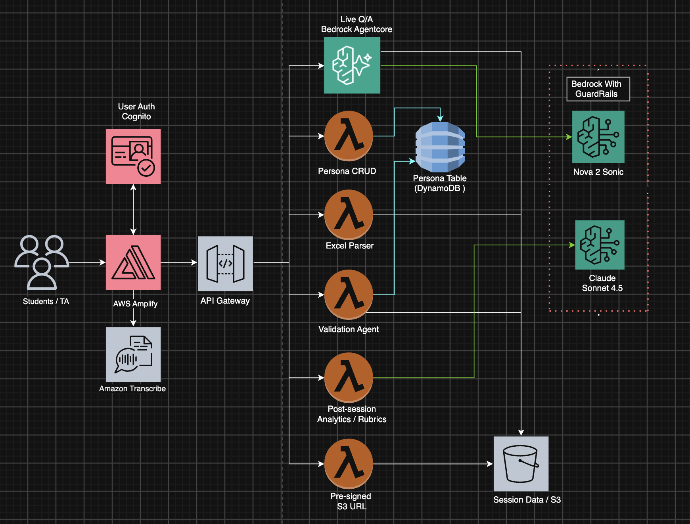

# AI Finance Case Presentation Assessor

An AI-powered platform that assesses individual student understanding of group financial case analyses through persona-based stakeholder Q&A sessions. Built for the W. P. Carey School of Business at Arizona State University.

---

## Overview

In group-based finance and real estate courses, students collaborate on case analyses but individual comprehension can be difficult to evaluate. This platform addresses that challenge by simulating a real-world executive presentation environment where each student must independently defend their group's analysis to an AI-powered stakeholder persona.

### How It Works

1. **Group Submission** — Student groups submit their financial case analysis (Excel workbook with financial models, assumptions, and property data)
2. **Individual Q&A Session** — Each student enters a live voice Q&A with an AI stakeholder persona (CEO, CFO, Investor, etc.) who asks targeted questions based on the group's actual submitted workbook
3. **AI Assessment** — The system evaluates responses across rubric categories: financial reasoning, assumption validation, recommendation defense, analytical depth, and more
4. **Instructor Review** — TAs and instructors review AI-generated assessment reports, override scores, and export results

### Student Q&A Session Features

- **Toggle View Mode** — Switch between full-width Q&A transcript and spreadsheet views for focused attention
- **Interactive Spreadsheet Viewer** — Browse the uploaded Excel workbook with formula dependency highlighting (referenced cells highlighted when selecting a formula cell)
- **AI Avatar with Anam Integration** — Visual avatar representation of the stakeholder persona with sentence-buffered text-to-speech for natural conversation flow
- **Live Transcript** — Real-time transcription of the conversation with speaker labels

---

## Key Features

- **Two-dashboard architecture** — Separate Student and TA/Instructor interfaces
- **Spreadsheet-aware questioning** — AI reads and references the group's actual Excel workbook during Q&A
- **Interactive spreadsheet viewer** — Excel-like formula dependency highlighting shows which cells are referenced
- **Persona-based stakeholder simulation** — Configurable AI personas (CEO, CFO, Board Members, Investors) with role-specific questioning styles
- **AI avatar visualization** — Anam-powered avatar with sentence-buffered TTS for natural speech flow
- **Structured rubric scoring** — Evaluates across 6 standardized dimensions with configurable weights
- **Voice-based interaction** — Real-time bidirectional voice Q&A powered by Amazon Nova 2 Sonic
- **Practice mode** — Unlimited practice sessions that don't count toward final grade
- **Instructor controls** — Persona management, rubric configuration, question customization, weight adjustments
- **Access code authentication** — Instructors set course access codes for streamlined student onboarding
- **Automated reporting** — PDF/JSON assessment reports with evidence citations from transcripts

---

## Architecture

Built on a serverless AWS architecture:



**Flow**

- **Students & TAs** access a Next.js frontend hosted on **AWS Amplify**, authenticated via **Amazon Cognito** (Student/TA roles).
- Standard requests route through **API Gateway (REST)** to a set of **AWS Lambda** functions, each handling one task:
  - **Persona CRUD** — manage AI stakeholder personas (DynamoDB)
  - **Excel Parser** — parse the uploaded workbook into structured JSON (S3)
  - **Validation Agent** — file/structure checks only; writes session status (S3 + DynamoDB, no AI model)
  - **Post-Session Analytics** — rubric scoring of the transcript (calls Claude)
  - **Pre-signed S3 URL** — secure upload/download links (S3)
- The **live voice Q&A** runs on **Bedrock AgentCore** over a WebSocket — a long-lived, stateful session (not Lambda, which is short and stateless).
- **Amazon Transcribe** (streaming, browser-side) captions the student's spoken presentation.
- Data is stored in **DynamoDB** (personas, sessions, assessments) and **Amazon S3** (uploads, transcripts, reports).

**Models (Amazon Bedrock, with Guardrails)**

- **Amazon Nova 2 Sonic** — real-time speech-to-speech voice for the live Q&A conversation.
- **Anthropic Claude Sonnet 4.5** — rubric-based assessment scoring. Called from three places, all using the same model and rubric: AgentCore (in-session, at session end), the Post-Session Analytics Lambda (stored assessment), and the Generate-AI-Score Lambda (TA-triggered scoring).
- **Amazon Bedrock Guardrails** screen the voice output in real time for content safety.

---

## Project Structure

```
AI-Finance-Case-Presentation-Assessor/
├── frontend/                          # Next.js 16 + React 19 + Tailwind 4
│   ├── app/
│   │   ├── student/                   # Student dashboard routes
│   │   │   ├── dashboard/             # Case overview, quick links, assessment details
│   │   │   ├── session/               # Live Q&A session (lobby → active → complete)
│   │   │   │   └── components/        # SessionLobby, LiveSession, SpreadsheetViewer, modals
│   │   │   ├── results/               # Assessment results and feedback
│   │   │   └── components/            # StudentHeader, StudentSidebar
│   │   ├── ta/                        # TA/Instructor dashboard routes
│   │   │   ├── dashboard/             # Overview stats, recent sessions, quick actions
│   │   │   ├── assessments/           # Student submissions table, review interface
│   │   │   ├── personas/              # Persona management (CRUD)
│   │   │   ├── rubrics/               # Rubric category weights configuration
│   │   │   └── components/            # TAHeader, TASidebar
│   │   ├── components/ui/             # Shared UI components
│   │   ├── config/                    # Fonts, constants
│   │   ├── context/                   # AuthContext (Cognito)
│   │   ├── hooks/                     # Custom React hooks
│   │   ├── services/                  # API service layer
│   │   └── utils/                     # Utility functions
│   ├── public/                        # Static assets
│   ├── package.json
│   ├── next.config.ts
│   └── tsconfig.json
│
├── backend/                           # AWS CDK (TypeScript) + Lambda (Python)
│   ├── bin/
│   │   └── backend.ts                 # CDK app entry — 4 stacks
│   ├── lib/
│   │   ├── backend-stack.ts           # Main stack: Cognito, S3, DynamoDB, Lambdas, API GW
│   │   ├── agentcore-stack.ts         # AgentCore runtime for voice Q&A
│   │   ├── amplify-hosting-stack.ts   # Amplify App hosting
│   │   └── frontend-config-stack.ts   # Branch env vars for frontend
│   ├── lambda/
│   │   ├── persona-crud/              # Stakeholder persona management
│   │   ├── excel-parser/              # Workbook parsing + structured extraction
│   │   ├── validation-agent/          # Submission validation before Q&A
│   │   ├── post-session-analytics/    # Rubric scoring + report generation
│   │   └── s3-presigned-url/          # Secure file upload/download URLs
│   ├── agentcore/                     # Bedrock AgentCore voice agent
│   │   ├── index.py                   # WebSocket handler, BidiAgent, assessment logic
│   │   ├── qa_system_prompt.jinja2    # Persona Q&A prompt template
│   │   ├── Dockerfile                 # Container for AgentCore runtime
│   │   └── requirements.txt           # Python dependencies
│   ├── test/                          # CDK tests
│   ├── package.json
│   ├── cdk.json
│   └── tsconfig.json
│
├── docs/                              # Documentation and scope
├── architecture.drawio                # Architecture diagram source
├── LICENSE                            # MIT
└── README.md
```

---

## Getting Started

### Prerequisites

- Node.js 18+ and npm
- AWS CLI configured with appropriate credentials
- AWS CDK CLI (`npm install -g aws-cdk`)
- Docker (for AgentCore container builds)
- Python 3.12 (for Lambda development)

### Frontend Development

```bash
cd frontend
npm install
npm run dev
```

The frontend runs at `http://localhost:3000` with two dashboards:
- `/student/dashboard` — Student view
- `/ta/dashboard` — TA/Instructor view

### Backend Deployment

```bash
cd backend
npm install
npx cdk deploy --all -c branchName=main
```

### Environment Variables

After CDK deployment, update `frontend/.env.local` with the stack outputs:

```
NEXT_PUBLIC_API_URL=<ApiUrl output>
NEXT_PUBLIC_USER_POOL_ID=<UserPoolId output>
NEXT_PUBLIC_USER_POOL_CLIENT_ID=<UserPoolClientId output>
NEXT_PUBLIC_IDENTITY_POOL_ID=<IdentityPoolId output>
NEXT_PUBLIC_AGENTCORE_WS_URL=<AgentCoreWebSocketUrl output>
NEXT_PUBLIC_AWS_REGION=us-east-1
```

---

## Assessment Categories

Scored with a standardized 6-dimension rubric (4 performance levels: Strong, Competent, Partial, Insufficient).

| Dimension | Weight | Description |
|-----------|--------|-------------|
| Problem Diagnosis and Financial Reasoning | 20% | Identifies the underlying problem; distinguishes causes from symptoms; connects evidence to business and financing consequences |
| Understanding of Calculations and Model Mechanics | 20% | Explains material formulas, methods, and statement linkages; traces numbers to assumptions; interprets rather than recites |
| Assumption Validation and Analytical Judgment | 20% | Identifies material assumptions; explains why they are reasonable; considers alternatives, sensitivity, and uncertainty |
| Analytical Integration and Ownership | 15% | Understands the entire submission; reconciles workbook, summary, and presentation; identifies inconsistencies |
| Recommendation Defense and Decision Quality | 20% | Provides feasible, evidence-based recommendations; quantifies impact; considers risks, trade-offs, and implementation |
| Executive Communication | 5% | Answers directly, organizes reasoning, explains clearly, acknowledges uncertainty, remains professional |

---

## Stakeholder Personas

The platform supports configurable AI personas for Q&A sessions:

- **CEO** — Strategic vision, growth, ROI, competitive positioning
- **CFO** — Financial models, risk management, assumptions, sensitivity analysis
- **Investor / Board Member** — Deal structure, exit strategy, market positioning
- **VP of Marketing** — Tenant acquisition, demand, competitive landscape
- **Custom** — Instructor-defined personas with specific questioning focus

---

## Project Status

🚧 **In Development** — Targeting Fall 2026 pilot deployment.

---

## Credits

Developed by the ASU AI Cloud Innovation Center powered by AWS.

---

## License

This project is licensed under the MIT License - see the [LICENSE](./LICENSE) file for details.

---

## Disclaimers

This application is a proof-of-concept developed for educational assessment purposes. It is not intended to replace faculty grading authority or serve as an automated academic misconduct determination system. AI-generated assessments are provisional and subject to instructor review and override.
